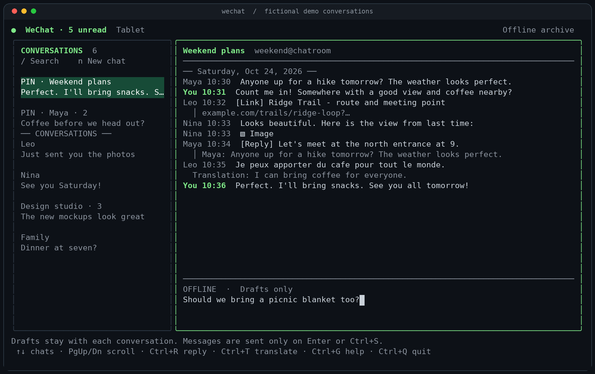

# wechat-cli

A standalone Go terminal client for personal WeChat messages. Run `wechat` to open the TUI, or use individual CLI commands. It connects directly through the native protocol; no WeChat desktop app or bridge service is required. The original bot backend remains available with `--backend ilink`.



*Actual TUI rendered with fictional conversations in offline mode.*

**Experimental:** tablet login and message sync have been tested, with the other clients remaining signed in on the tested account. Desktop login may replace another desktop session. The phone profile has passed QR request/poll tests; full phone login remains untested and may replace your phone session.

## Build and login

Requires Go 1.25 or newer. [GitHub Actions](https://github.com/kevmo314/wechat-cli/actions) produces Linux, macOS, and Windows binaries for amd64 and arm64, with checksums.

```sh
go build -o bin/wechat .
# Scan the terminal QR and approve on your phone.
./bin/wechat --profile tablet login
./bin/wechat --profile tablet
```

Choose `--profile phone`, `--profile tablet`, or `--profile desktop`. Each profile keeps separate credentials. The TUI remembers your selected profile and lets you change it with Ctrl+P. Existing tablet state in `~/.config/wechat-tablet` is recognized. Global flags precede the command.

`wechat login --profile tablet` selects the same account directory as `wechat --profile tablet login`. Without a profile flag, `login` uses desktop. If matching saved profiles exist in multiple directories, the CLI reports the paths instead of choosing one silently. Select the intended session and its archive with `wechat --config-dir DIR --profile desktop status` (or `read` / `tui`); existing files are preserved.

The terminal QR uses explicit black-on-white colors. Server PNG/JPEG QR images are scanned and rerendered as terminal blocks. `login --qr login.png` also saves an image; `login --resume` resumes an unexpired attempt. New-device phone/LAN verification challenges are detected but not implemented.

## Terminal interface

The conversation list stays visible and the message box stays focused. Messages have compact sender/time labels and indented wrapped lines. Pinned chats are marked `PIN`; unread counts and terminal notifications indicate incoming messages. Viewed conversations send read-state updates while visible, focused, and scrolled to the bottom.

The native message timestamp has whole-second precision. Messages in the same second are ordered by WeChat's server sequence within each conversation, when available. Old archives recover this sequence from their stored sync payloads; messages without sequence metadata retain arrival order.

| Action | Key |
| --- | --- |
| Switch chats | Up / Down |
| Scroll messages | PgUp / PgDn |
| Send | Enter or Ctrl+S |
| New line | Alt+Enter or Ctrl+J |
| Search / new chat | Ctrl+K / Ctrl+N |
| Select a message | Click it |
| Reply to selected message (latest incoming by default) | Ctrl+R or right-click |
| Cancel reply | Ctrl+X |
| View quoted original | Click its quoted preview |
| Open a link | Click the link or shared-link message |
| Translate / hide translation | Ctrl+T |
| Download attachment / view image | Ctrl+O, then select and Enter |
| Choose device profile | Ctrl+P |
| Contacts page | Alt+C, or Ctrl+G then C |
| Optional message details | Ctrl+E |
| Refresh / retry sync | Alt+S |
| Restore failed send | Ctrl+Y |
| Help / quit | Ctrl+G / Ctrl+Q |

Translations use WeChat's authenticated server API, with no separate translation account or API key. English is the default; use `tui --language zh_CN` to change it. Translations appear below the original and are cached privately. Deleted messages are marked and cannot be quoted or translated. Group names use contact and group-member data when available.

Images render as colored terminal blocks. Image and file downloads are supported; voice/video downloads and media uploads are not implemented. On a remote terminal, opening a URL may require your terminal's Ctrl+click support. Quoted replies are implemented but have not yet been tested with a live send.

Drafts stay with each chat and clear immediately when submitted. Failed sends can restore their draft; interrupted sends are never automatically retried because delivery may be uncertain.

The Contacts page searches known contacts and chats by name, remark, alias, or ID. Tab cycles All / People / Groups / Pinned; Enter opens the selected chat. Ctrl+R edits the contact's WeChat remark (Enter saves, empty removes it); Ctrl+P pins or unpins the chat on WeChat. Esc returns to your draft. Changes require a connection and update the display after server acceptance. Contact lookup and an empty update request were tested live; actual remark/pin changes still need live confirmation. Adding/removing friends is not implemented.

## CLI commands

```sh
./bin/wechat status
./bin/wechat read --follow
./bin/wechat history --limit 50
./bin/wechat contacts
./bin/wechat send --to RECIPIENT_ID --text 'Hello!'
./bin/wechat send --to RECIPIENT_ID --text 'Reply' --reply-to MESSAGE_ID
./bin/wechat wait --timeout 60s --json
./bin/wechat wait --from RECIPIENT_ID --json
./bin/wechat attachment --id MESSAGE_ID --preview
./bin/wechat translate --text '你好，世界' --lang en
./bin/wechat translate --id MESSAGE_ID --lang en
./bin/wechat mark-read --to RECIPIENT_ID
./bin/wechat tui --offline
```

Use `--help` on a command for options. `wait` returns the next new incoming message and works alongside the TUI by observing its sync journal. With no reader running, it performs sync itself. A timeout exits unsuccessfully. `read` drains available sync pages; `--follow` continues polling. `read --json` and `history` emit one message per JSON line.

**History scope:** initial desktop and tablet sync returned existing messages, but this does not establish access to all conversations or all historical messages. `history` reads only this CLI's archive. Phone migration/backup and official desktop database import are not implemented.

## State and concurrency

State defaults to `~/.config/wechat-cli` on Linux, respecting `XDG_CONFIG_HOME`. Native state lives in its `native/` subdirectory, separately from existing iLink state. Credentials and approval grants are plaintext, private files (`0600` in `0700` directories). Do not share the config directory or sync journals.

All sync commands, including unknown types, are archived under `native/batches/` before the cursor is committed. `history` deduplicates messages by account and message ID. If output is interrupted after a cursor commit, inspect `history` to recover the archived messages. Files are written atomically and synced to disk.

Only one reader/login/logout process can run per config directory. Sending can run alongside a reader; account updates are serialized. Multiple processes do not provide additional desktop sessions.

```sh
# Global flags must precede the command.
./bin/wechat --config-dir ~/.config/wechat-work login
./bin/wechat --config-dir ~/.config/wechat-work read --follow
./bin/wechat logout
```

`logout` deletes local credentials and cursor but retains the archive. It does not remotely revoke the device authorization; manage that on your phone. It also does not restore a desktop session displaced during login.

## Protocol and validation

The Go implementation verifies MMTLS server signatures and encrypted records, then uses encrypted native protobuf calls for QR request/poll, phone-grant authentication, sync, and text sends. Profiles were investigated using the official Linux 4.1.13.26 client and Android 8.0.79 APK. There is no insecure signature-verification switch. Request notice checksums currently use zero; the tested server accepted QR, authentication, and sync requests, but compatibility with other accounts/builds is not established.

See [native protocol findings](docs/native-protocol.md) for the inspected official binary, route IDs, protocol references, and live validation limits. See [iLink usage](docs/ilink.md) for the original bot backend. This is an independent client, not an official Tencent product.

```sh
go test -race ./...
go vet ./...
```

Tests cover authenticated transport records, encrypted business fixtures, phone approval/challenge handling, cursor merge/reset, send-receipt identity matching, unknown sync payload retention, private archive permissions, replay deduplication, and separation from bot credentials. Existing iLink HTTP and QR image/rendering tests remain in place. Live tests verified desktop and tablet QR login, account synchronization, and server acceptance of one user-authorized outgoing tablet text message.
